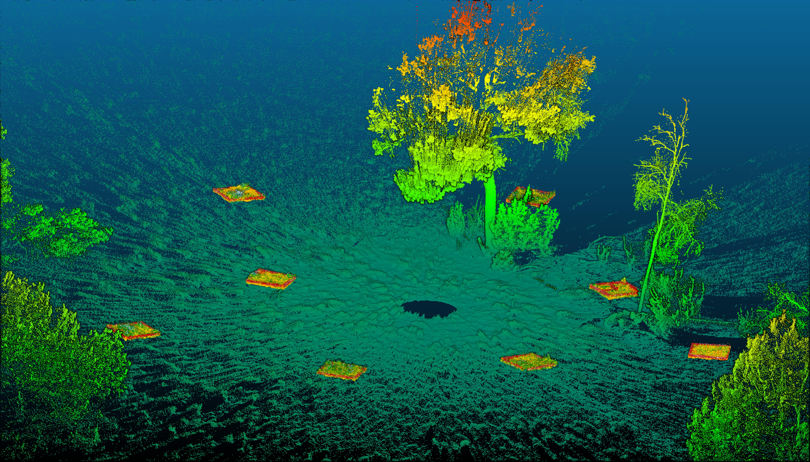
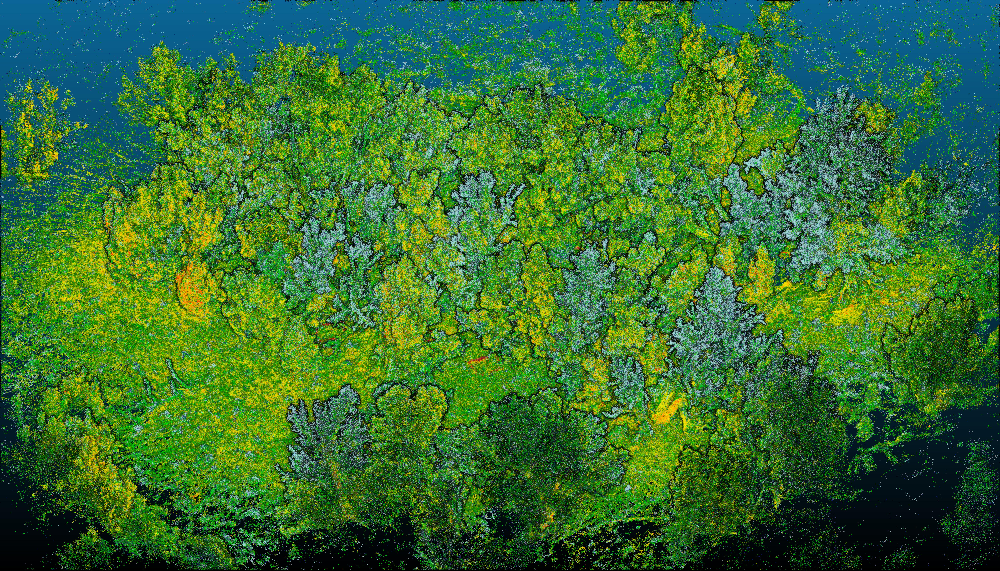
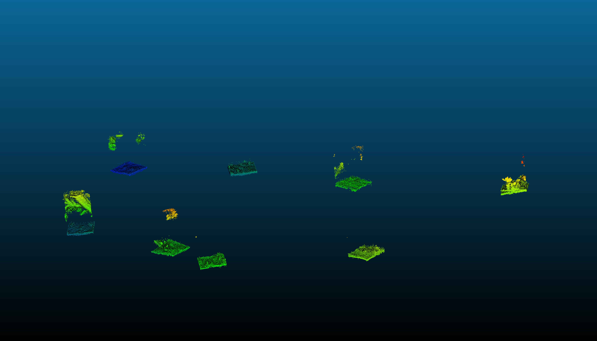

# QuadratDetectR

`QuadratDetectR` provides an automated approach to extracting LiDAR points from within field quadrats. This requires an MLS scan of a plot with reflective tape wrapped quadrats.

## How quadrats are identified

This workflow was developed using data from piñon-juniper woodland plots sampled as part of [Nate Beine's master's thesis](https://www.proquest.com/docview/3344191296?pq-origsite=gscholar&fromopenview=true).

1. **Load the LiDAR point cloud**

   The script reads in an MLS point cloud containing the surveyed ground surface and any reflective quadrat markers. It can optionally also extract points from a TLS point cloud that is properly aligned spatially with the MLS point cloud.

   

   *Original LiDAR point cloud used for quadrat detection.*

2. **Identify reflective tape returns**

   Reflective tape produces distinctive, high-intensity returns in the LiDAR data. The point cloud is filtered to retain points that are likely to belong to the tape rather than vegetation, soil, or other objects.

3. **Group nearby candidate points**

   The remaining points are grouped spatially so that returns belonging to the same physical quadrat are treated as a single candidate. Small, isolated groups can be removed as noise.

4. **Fit a square to each candidate**

   For each candidate group, the script estimates the quadrat's position, orientation, and dimensions. A fitted square is then drawn around the detected tape points.

   

   *Detected quadrats extracted from the LiDAR point cloud.*

5. **Check the fitted quadrats**

   The fitted squares can be inspected to confirm that they align with the reflective tape and represent the intended 1 m² quadrats. This step is useful for identifying false detections, overlapping quadrats, or poor-quality fits.

6. **Extract points within each quadrat**

   Once the quadrat boundaries have been identified, the script selects the LiDAR points inside each 1 m² square. These extracted points can then be saved or used for downstream analyses of vegetation structure and composition.

   

   *MLS point cloud showing the extracted quadrats.*
