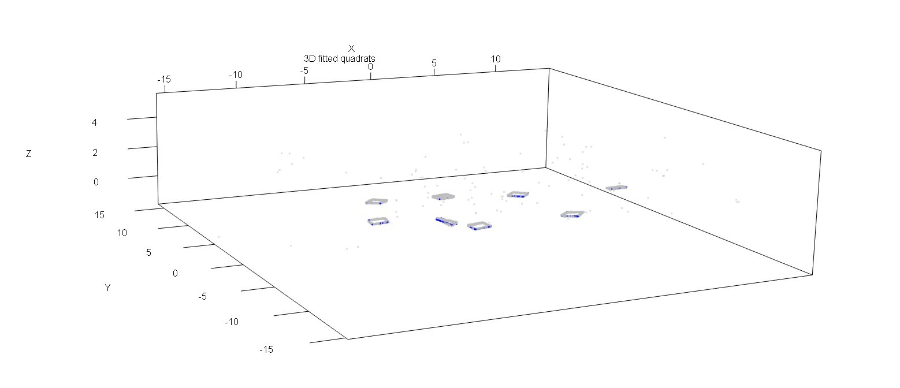

## How quadrats are identified

`QuadratDetectR` locates 1 m² quadrats in ground-based LiDAR point clouds by using the reflective tape placed around each quadrat as a visual and geometric marker. The general workflow is:

This workflow was developed using data from piñon-juniper woodland plots sampled as part of [Nate Beine's master's thesis](https://www.proquest.com/docview/3344191296?pq-origsite=gscholar&fromopenview=true&sourcetype=Dissertations%20&%20Theses).

1. **Load the LiDAR point cloud**  
   The script reads a TLS or MLS point cloud containing the surveyed ground surface and any reflective quadrat markers.

2. **Identify reflective tape returns**  
   Reflective tape produces distinctive, high-intensity returns in the LiDAR data. The point cloud is filtered to retain points that are likely to belong to the tape rather than vegetation, soil, or other background features.

   <!-- Optional image: show the original point cloud with the reflective tape returns highlighted. -->
   <!-- Suggested filename: docs/images/01-reflective-tape-returns.png -->

3. **Group nearby candidate points**  
   The remaining points are grouped spatially so that returns belonging to the same physical quadrat are treated as a single candidate. Small, isolated groups can be removed as noise.

   <!-- Optional image: show candidate reflective-tape point clusters before fitting. -->

4. **Fit a square to each candidate**  
   For each candidate group, the script estimates the quadrat's position, orientation, and dimensions. A fitted square is then drawn around the detected tape points. In diagnostic plots, these fitted squares are shown in blue.

   <!-- Optional image: show the blue fitted squares around the detected quadrats. -->
   <!-- Suggested filename: docs/images/03-blue-fitted-squares.png -->

   Example:

   

5. **Check the fitted quadrats**  
   The fitted squares can be inspected to confirm that they align with the reflective tape and represent the intended 1 m² quadrats. This step is useful for identifying false detections, overlapping quadrats, or poor-quality fits.

   <!-- Optional image: show a correctly fitted square and an example of an incorrect or rejected fit. -->
   <!-- Suggested filename: docs/images/04-fit-quality-check.png -->

6. **Extract points within each quadrat**  
   Once the quadrat boundaries have been identified, the script selects the LiDAR points inside each 1 m² square. These extracted points can then be saved or used for downstream analyses of vegetation structure and composition.

   <table>
     <tr>
       <td align="center"><strong>Source point cloud</strong></td>
       <td align="center"></td>
       <td align="center"><strong>Extracted quadrats</strong></td>
     </tr>
     <tr>
       <td align="center"></td>
       <td align="center"><strong>→</strong></td>
       <td align="center"></td>
     </tr>
   </table>

   <!-- Optional image: show the final isolated point cloud for one quadrat. -->
   <!-- Suggested filename: docs/images/05-isolated-quadrat-points.png -->

### Suggested workflow figure

A single overview figure could also be used to show the complete process:

> Raw point cloud → reflective tape filtering → candidate clusters → blue fitted squares → isolated quadrat point clouds

<!-- Optional image: add a multi-panel workflow figure here. -->
<!-- Suggested filename: docs/images/quadrat-identification-workflow.png -->

